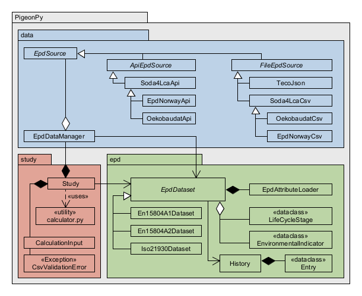
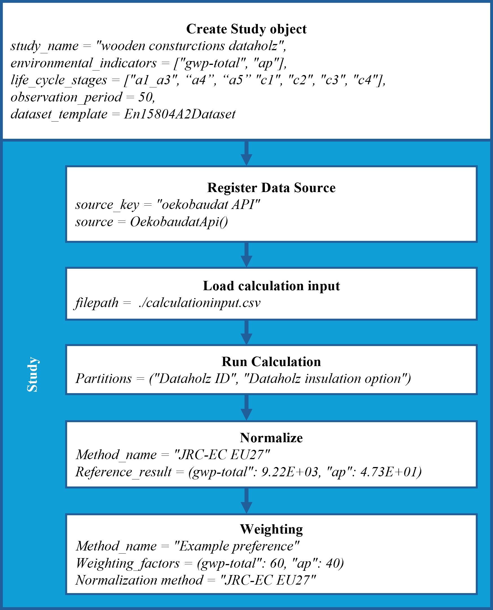

# PigeonPy
> **PigeonPy** is an open-source Python library for importing, processing, calculating, and analyzing **Environmental Product Declaration (EPD)** data to perform Life Cycle Assessment (LCA) of buildings.


### Key Features

<table>
  <tr>
    <td>📦 <strong>EPD Import</strong></td>
    <td>Import data from <strong><a href="https://bitbucket.org/okusche/soda4lca">soda4LCA</a></strong> nodes (e.g. <a href="https://www.oekobaudat.de/en.html">ÖKOBAUDAT</a>, <a href="https://epdnorway.lca-data.com/">epd-global (EPD-Norway)</a>, etc.), CSV, and <a href="https://github.com/RWTH-E3D/Teco">Teco</a> JSON.</td>
  </tr>
  <tr>
    <td>📐 <strong>Multiple Standards</strong></td>
    <td>Work with <strong>EN 15804+A1</strong>, <strong>EN 15804+A2</strong>, and <strong>ISO 21930</strong>.</td>
  </tr>
  <tr>
    <td>🔄 <strong>Multiple Formats</strong></td>
    <td>Support for <strong>ILCD+EPD</strong> XML, <a href="https://bitbucket.org/okusche/soda4lca">soda4LCA</a> CSV, and <a href="https://github.com/RWTH-E3D/Teco">Teco</a> JSON.</td>
  </tr>
  <tr>
    <td>🧩 <strong>Flexible Calculations</strong></td>
    <td>Build calculations using arbitrary <strong>Partitions and Subsets</strong> (see <a href="https://github.com/RWTH-E3D/pigeonpy/tree/main/examples">examples</a>).</td>
  </tr>
  <tr>
    <td>📊 <strong>Normalization</strong></td>
    <td>Normalize calculated environmental impact results.</td>
  </tr>
  <tr>
    <td>⚖️ <strong>Weighting</strong></td>
    <td>Apply weighting to support further result aggregation and analysis.</td>
  </tr>
  <tr>
    <td>🔍 <strong>Result Analysis</strong></td>
    <td>Analyze and process calculated EPD results in a reproducible workflow.</td>
  </tr>
</table>


See the [`examples`](https://github.com/RWTH-E3D/pigeonpy/tree/main/examples) for practical use cases.


[//]: # "Supported standards for EPD data: EN 15804+A1, EN 15804+A2, and ISO 21930"
[//]: # "Supported EPD sources: [soda4LCA](https://bitbucket.org/okusche/soda4lca) nodes such as [ÖKOBAUDAT](https://www.oekobaudat.de/en.html) or [epd-global (EPD-Norway)](https://epdnorway.lca-data.com/), CSV, JSON"
[//]: # "Supported EPD data formats: ILCD+EPD XML, [soda4LCA](https://bitbucket.org/okusche/soda4lca) node CSV export format, [Teco](https://github.com/RWTH-E3D/Teco) JSON"
[//]: # "Calculation of results based on an arbitrary number of user defined Partitions and Subsets (see [examples](https://github.com/RWTH-E3D/pigeonpy/tree/main/examples)"
[//]: # "Normalization and Weighting functionality"

### Architecture version 0.0.9(?):




## Installation

PigeonPy is currently developed for **Python 3.11+**.

### Install from GitHub

To install the latest version directly from the repository:

```bash
pip install git+https://github.com/RWTH-E3D/pigeonpy
```

### Clone the Repository

Alternatively, clone the repository if you want to develop or modify PigeonPy locally:

```bash
git clone https://github.com/RWTH-E3D/pigeonpy
cd pigeonpy
```

For a regular installation:

```bash
pip install .
```

For development, install PigeonPy in **editable mode**:

```bash
pip install --editable .
```


---

## Usage

For examples of how to use PigeonPy, see the [examples](https://github.com/RWTH-E3D/pigeonpy/tree/main/examples).

> **Documentation:** [Documentation LINK ZU GITHUB PAGES HINZUFÜGEN](...)

### Example Workflow

The following diagram illustrates an example workflow using **PigeonPy**:



---

### Issues
If you encounter a problem or unexpected behavior, please [open an issue](https://github.com/RWTH-E3D/pigeonpy/issues) or reach out to one of the developers.

---

### Contributing
You are invited to contribute to the development of PigeonPy.

The project is designed to support future developments, particularly with regard to:

* new EPD data formats
* additional EPD data sources
* extensions to the calculation and analysis functionality

If you are interested in contributing, feel free to open an issue to discuss a proposed change or submit a pull request.

---

## How to cite
If you use __PigoenPy__ in your academic work, please cite our journal paper:
> **Citation:** [doi link hier einfügen](...)

### BibTeX:
```bibtex
@article{
NOCH EINFÜGEN
}
```
