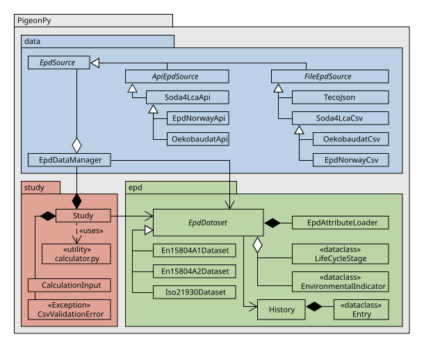

API Reference
=============

**The API is organized into the following packages:**

**The API reference is organized according to the PigeonPy package structure.**

.. toctree::
   :maxdepth: 4

   generated/modules

